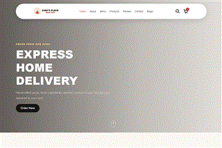

# HTML5 CSS3 Pro — Chef's Place
Responsive restaurant website based on the supplied course screenshot and video reference.
## Features
- Rounded restaurant navigation with responsive mobile menu
- Pizza delivery hero and anchored sections: About, Menu, Products, Review, Contact, Blogs
- Menu search filters the food cards
- Demo cart can add/remove items and calculate the total; no checkout/payment is sent
- Contact form displays a local demo message and sends nothing
## Run
Open index.html with Live Server. Food photography is loaded from Unsplash, so internet access is needed.
## Reference
https://www.youtube.com/watch?v=3zbtWSpsFV4

## Önizleme

GIF ekran önizlemesidir; React projelerinde gönderdiğin referans ekran görüntüsü kullanılmıştır.

