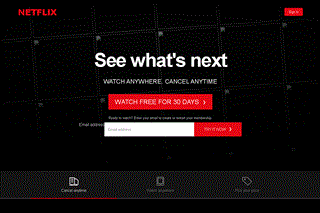

# Netflix-style Landing Page

A responsive Netflix landing-page clone made with HTML, CSS, and JavaScript for the JS Pro 1 course project.

## Features

- Poster-collage hero with a responsive navigation header
- Three working feature tabs: Cancel anytime, Watch anywhere, Pick your price
- FAQ accordion
- Email forms open a local demo dialog
- Sign-in and trial buttons open interactive demo forms
- Dialogs explain that no account, email, or payment is sent or created
- Responsive layout for desktop and mobile

## Run locally

Open this folder in VS Code and run index.html with Live Server.

## Preview

Add a short GIF after recording the hero, tab changes, FAQ, and demo dialog.

## Technologies

HTML · CSS · JavaScript

## Önizleme

GIF ekran önizlemesidir; React projelerinde gönderdiğin referans ekran görüntüsü kullanılmıştır.

