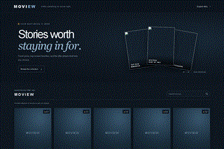

# MOVIEW — Responsive Movie Website

Responsive movie discovery page built with HTML, CSS, and the JavaScript Fetch API. It loads its starter catalog from a local JSON file and filters the cards as the visitor types in the search field.

## Features

- Responsive five-column desktop movie catalog
- Movie posters, ratings, genre, year, and overview
- Hover and keyboard-focus overview panel
- Live title search with a no-results state
- Loading and data-file error states

## Run locally

Open this folder in VS Code and run index.html with Live Server. The Fetch API needs a local web server; opening the file directly is not supported.

## Önizleme

GIF ekran önizlemesidir; React projelerinde gönderdiğin referans ekran görüntüsü kullanılmıştır.

## Technologies

HTML · CSS · JavaScript Fetch API

