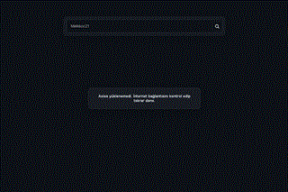

# GitHub Profil Kartları

Axios ve GitHub REST API ile kullanıcı arayıp profil kartı gösteren HTML/CSS/JavaScript projesi. Sayfa açıldığında Melikkoc21 araması yapılır; kutuya başka bir GitHub kullanıcı adı yazarak yeni profil de aranabilir.

## Özellikler

- Axios ile GitHub profil bilgisini alma
- Profil fotoğrafı, ad, kullanıcı adı ve takipçi/takip edilen/depo sayılarını gösterme
- Enter veya arama düğmesiyle arama
- Yükleniyor, bulunamadı ve bağlantı hatası durumları
- Mobil ekrana uyumlu koyu tema

## Çalıştırma

Klasörü VS Code'da açıp Live Server ile index.html dosyasını çalıştır. Profil verisi için internet bağlantısı gerekir.

## Önizleme

GIF ekran önizlemesidir; React projelerinde gönderdiğin referans ekran görüntüsü kullanılmıştır.

## Kullanılan teknolojiler

HTML · CSS · JavaScript · Axios · GitHub REST API

