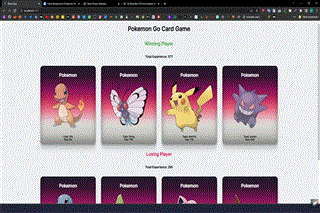

# Pokemon Go Card Game

A React card game inspired by the course project. Each page load deals eight different Pokémon into two teams. The app totals their experience points, labels the higher-scoring team as the winner, and shows the other team as the loser.

## Features

- Random teams on every page refresh, with no duplicate cards in a round
- Team experience totals determine the winner
- Pokémon cards show type and experience
- Cards grow slightly on hover
- Responsive card grid for desktop and mobile
- Artwork fallback when remote images are unavailable

## Run locally

Install dependencies with npm install, then start the development server with npm run dev.

## Önizleme

GIF ekran önizlemesidir; React projelerinde gönderdiğin referans ekran görüntüsü kullanılmıştır.

## Technologies

React · JavaScript · CSS · Vite

