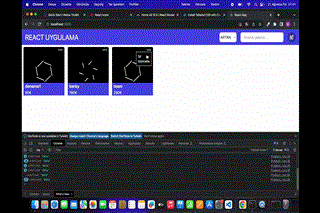

# React Uygulama

React ve Redux Toolkit ile hazırlanmış ürün yönetimi uygulaması. Ekran düzeni, kullanıcının gönderdiği ders videosu görüntüsüne göre kuruldu.

## Özellikler

- Ürün adıyla anlık arama
- Fiyata göre artan veya azalan sıralama
- Yeni ürün ekleme
- Kart menüsünden ürünü güncelleme veya silme
- Form doğrulaması ve boş arama sonucu durumu
- Ürünlerin tarayıcıda saklanması
- Dar ekranlara uyumlu kart düzeni

## Çalıştırma

```bash
npm install
npm run dev
```

## Önizleme



GIF ekran önizlemesidir; React projelerinde gönderdiğin referans ekran görüntüsü kullanılmıştır.

## Kullanılan araçlar

React · Redux Toolkit · React Redux · Vite


