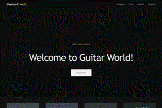

# SASS Pro — Guitar World
Ekran görüntülerindeki koyu temalı Guitar World tanıtım/mağaza sayfası için responsive kurs projesi.
## Özellikler
- Hero, navigasyon ve Shop now bağlantısı
- Dört özellik kartı, gitar fotoğraf galerisi ve hover CHECK etiketi
- Mobil navigasyon menüsü
- Sass değişkenleri, mixin, nesting ve responsive media query
## Çalıştırma
index.html dosyasını Live Server ile aç. Fotoğraflar Unsplash üzerinden yüklendiğinden internet gerekir.
Sass kaynağını yeniden derlemek için: sass scss/main.scss style.css
## Referans
https://www.youtube.com/watch?v=U3Z11M9mFiY

## Önizleme

GIF ekran önizlemesidir; React projelerinde gönderdiğin referans ekran görüntüsü kullanılmıştır.

